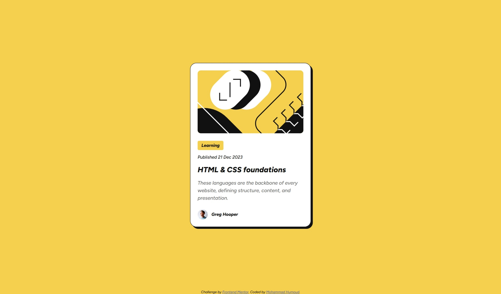

# Frontend Mentor - Blog preview card solution

This is a solution to the [Blog preview card challenge on Frontend Mentor](https://www.frontendmentor.io/challenges/blog-preview-card-ckPaj01IcS). Frontend Mentor challenges help you improve your coding skills by building realistic projects. 

## Table of contents

- [Overview](#overview)
  - [The challenge](#the-challenge)
  - [Screenshot](#screenshot)
  - [Links](#links)
- [My process](#my-process)
  - [Built with](#built-with)
  - [What I learned](#what-i-learned)
  - [Continued development](#continued-development)
  - [Useful resources](#useful-resources)

## Overview

### The challenge

Users should be able to:

- See hover and focus states for all interactive elements on the page

### Screenshot



### Links

- Solution URL: [Solution URL](https://github.com/mh2000hm/blog-preview-card-main)
- Live Site URL: [Live Site URL](https://mh2000hm.github.io/blog-preview-card-main)

## My process

### Built with

- Semantic HTML5 markup
- CSS custom properties
- Flexbox
- Figma

### What I learned

I learned how to save color palette in custom CSS varialbes at the top of the stylesheet:
```css
:root {
  --yellow-color: #F4D04E;
  --gray-950: #111111;
  --gray-500: #6B6B6B;
}
```

I learned how to import a TrueType Font in CSS:
```css
@font-face {
  font-family: 'Figtree';
  src: url('assets/fonts/Figtree-Italic-VariableFont_wght.ttf') format('truetype'),
       url('assets/fonts/Figtree-VariableFont_wght.ttf') format('truetype'),
       url('assets/fonts/static/Figtree-ExtraBold.ttf') format('truetype'),
       url('assets/fonts/static/Figtree-Medium.ttf') format('truetype');
}
```

I learned how to use hover and focus states with smooth transitions:
```css
.blog-preview-card {
  box-shadow: inset 0 0 0 1px var(--gray-950),
              6px 6px 0 0px var(--gray-950);
  transition: box-shadow 1s ease-in-out;
}
.blog-preview-card:hover {
  box-shadow: inset 0 0 0 1px var(--gray-950),
              12px 12px 0 0px var(--gray-950);
}
```

### Continued development

I would like to get more practice with CSS Flexbox and CSS Grid properties.

### Useful resources

- [Mozilla MDN](https://developer.mozilla.org/) - Excellent reference for HTML and CSS 
- [Google Fonts](https://fonts.google.com/) - Great resource for finding fonts
